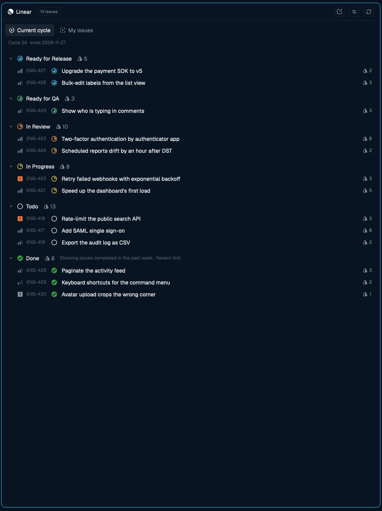
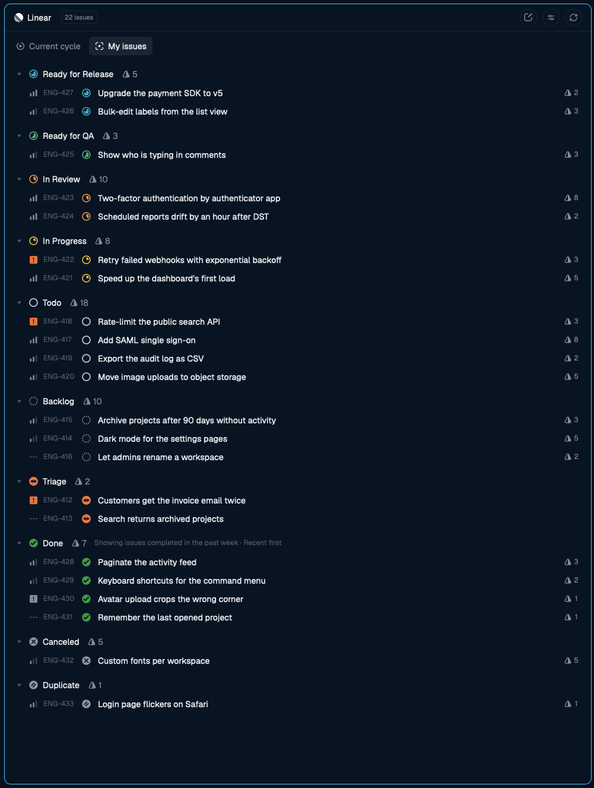

For a while, my agent setup was the Herdr TUI running inside Ghostty. I recently started using the new [Herdr desktop app](https://herdr.dev/) instead, and I'm starting to like it a lot.

## A simple layout and one mod

My layout is simple: Herdr's default one plus a Linear panel that I wrote.

The mod lists my Linear issues and covers the actions I use the most:

- update the status, priority, estimate and assignee
- copy the issue in various forms
- start a Claude Code session from the issue

The only thing I left out for now is the label management, it's quite a lot of UI and I usually change the label only when I create a new issue, so not something I would do here but directly on Linear instead. Nonetheless, everything else I regularly do in Linear is there.

The goal is that during a sprint cycle I can mostly live on my terminal.

## Starting a session from an issue

The feature I expect to use the most is starting a Claude Code session in a worktree, straight from an issue. The mod builds the prompt from three parts, in this order:

1. a base prompt, set once in my settings
2. a prompt I can add on the fly for this particular issue
3. the issue itself, as Linear's "Copy as prompt" gives it

An issue goes from the panel to an agent working on it, with the context I always want and the details that only this issue needs.

## What's next

It looks promising. I plan to publish the mod on GitHub soon, so it shows up in the Herdr gallery. Once it's done, and after at least a week of daily use, I'll write a follow-up with more details.

Here are some screenshots of the panel in Herdr with my Night Owl theme that I use everywhere.

